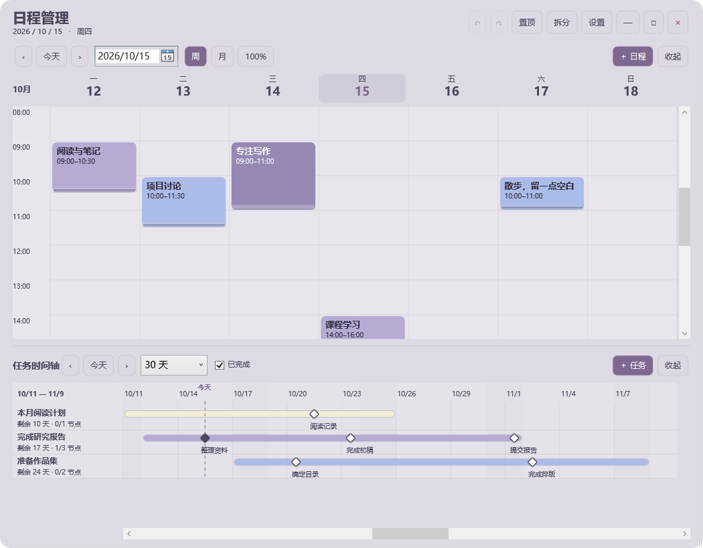
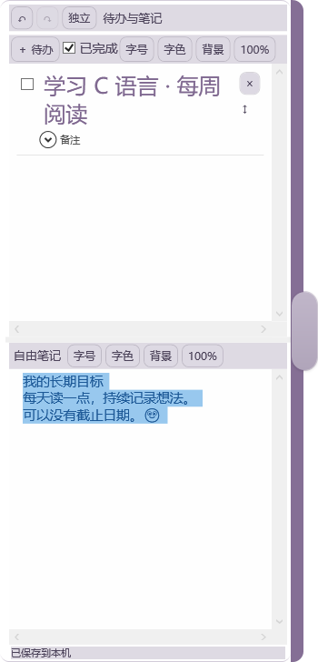
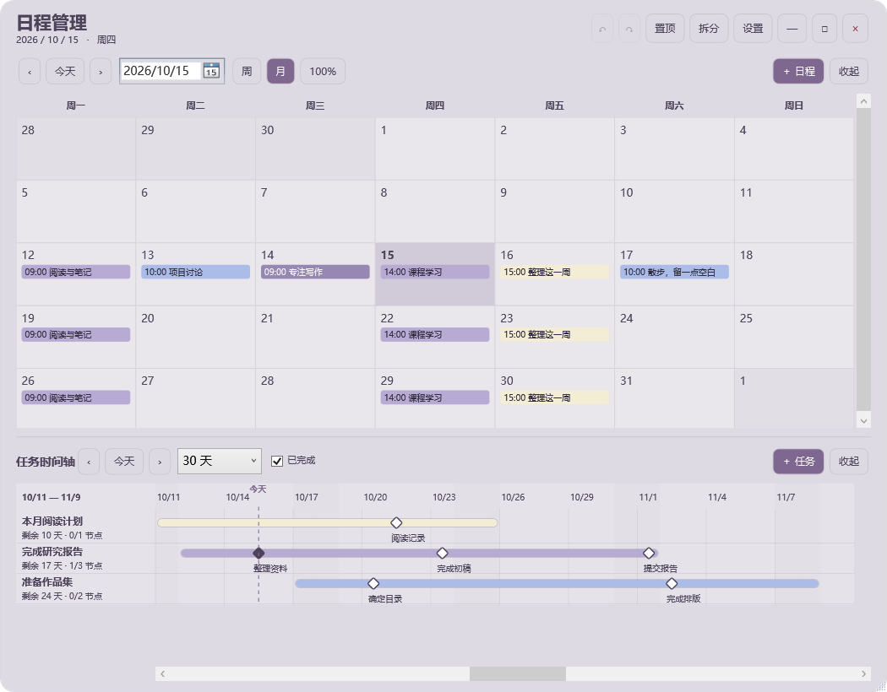
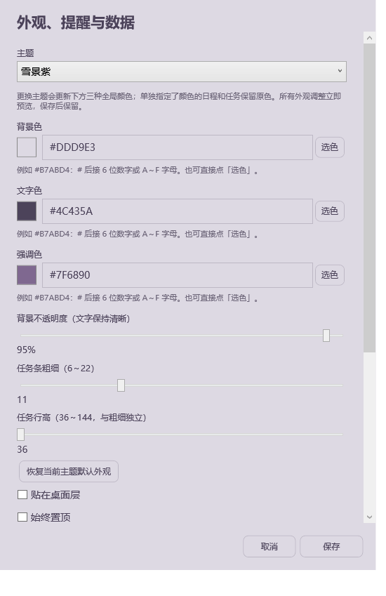

# 日程管理 · DesktopTodo

把周／月日程与任务截止时间放在 Windows 桌面上。适合同时安排固定时间的活动，以及需要跨天推进的任务。

**[下载 0.1.3.2 预览版](https://github.com/Caylicia3/Tools/releases/tag/desktop-todo-v0.1.3.2)** · [使用说明](USAGE.txt) · [设计说明](docs/ARCHITECTURE.md) · [构建与测试](docs/DEVELOPMENT.md)

当前版本为 **0.1.3.2 预览版**。新增待办与笔记侧栏：清单依附在日程或时间轴外侧，拉动时主窗口的位置和尺寸保持不变。右侧空间不足时使用左侧；两侧均不足时提示先还原或移动主窗口。

## 能做什么

- **周／月日程**：按真实日期浏览，支持重叠事件、每周重复、拖选新增、移动和调整时长。
- **待办与笔记侧栏**：记录没有截止日期的目标与想法，支持逐字字号／颜色、待办排序、独立窗口和右侧停靠。
- **任务时间轴**：每项任务单独一行，显示起止日期与节点；拖动底部滚动条浏览其他日期，Ctrl＋滚轮缩放日期范围。
- **编辑与撤销**：节点拖动时预览目标日期，松手保存；支持最近 100 步内容操作的撤销和重做。
- **独立提醒**：任务和节点分别选择提醒时间或“不提醒”；完成后静默，重新打开时汇总错过的提醒。
- **可调整的桌面面板**：四套主题、自定义颜色、透明度与尺寸实时预览；支持拆分、置顶、最大化和任务栏恢复。
- **本地数据**：SQLite 保存日程与设置，支持导出、恢复和每日备份；无需账号或在线服务。

月视图与设置预览

以上为实际程序界面，使用独立的虚构演示数据。

## 下载与运行

支持 **Windows 10 22H2／Windows 11，x64（Intel／AMD）**。发布包包含运行组件，不需要安装 .NET SDK 或开发工具。

| 文件 | 用途 |
| --- | --- |
| `DesktopTodo-0.1.3.2-win-x64-Setup.exe` | 标准安装包，优先选择 |
| 文件名包含 `Compatibility-Setup` | 标准版无法启动时可尝试的兼容安装包 |
| 文件名以 `.zip` 结尾 | 免安装版；完整解压后运行 `DesktopTodo.exe` |

标准版保留 CET 硬件栈保护。兼容版只关闭本程序启动文件的 CET 标记，不改变系统设置；功能和数据格式相同。已验证的 Windows 10 测试机使用了此兼容方式。具体测试范围见 [验证记录](TEST-REPORT.md)。

1. 在 [Release 页面](https://github.com/Caylicia3/Tools/releases/tag/desktop-todo-v0.1.3.2) 下载相应安装包。
2. 选择程序目录和数据目录；数据目录必须位于程序目录之外。
3. 按需勾选桌面快捷方式，安装后双击“日程管理”。

程序**不会开机自启动**。点击“—”最小化后继续提醒；点击主面板“×”会关闭全部面板与后台提醒。Win+D 会暂时最小化面板，可从任务栏恢复。独立清单窗口的“×”只隐藏清单，可用顶部“清单”或托盘恢复。

升级前建议导出备份并完全退出程序。升级沿用原数据目录，卸载保留日程数据；免安装版升级时保留原 `data-location.txt`。

## 常用操作

| 操作 | 方法 |
| --- | --- |
| 打开待办与笔记 | 点击右边缘无文字把手或顶部“清单”；横向拖动把手调整宽度 |
| 清单与笔记编辑 | 直接输入，选中文字后调整字号／字色；两区可分别缩放和设置背景 |
| 独立与合并 | 点击“独立”，用“合并”选择宿主，或拖动独立窗口标题靠近目标右边缘 |
| 新增或修改日程 | 使用新增按钮、拖选时间段，或点击已有事件 |
| 编辑任务日期 | 点击任务名称或彩色条；任务条不支持拖动改期 |
| 移动节点 | 拖动菱形查看日期，松手保存；Esc 取消 |
| 撤销／重做 | Ctrl+Z／Ctrl+Y，也支持 Ctrl+Shift+Z |
| 缩放 | 鼠标放在图表内，按住 Ctrl 滚动滚轮 |
| 浏览时间轴 | 底部滚动条，或拖动日期刻度及空白区域 |
| 调整外观 | 设置中实时预览；保存保留，取消恢复 |
| 自定义颜色 | 点击“选色”，或输入 `#B7ABD4` 这样的六位十六进制颜色 |

默认使用托盘提醒；“系统通知”为可选模式，需要向 Windows 注册通知入口。提醒还受 Windows 通知及勿扰设置影响。关闭程序期间不会弹出提醒。

## 了解实现

界面使用 **WPF / .NET 10**；日期、提醒和存储逻辑位于独立的 Core 项目中。SQLite 事务保存完整应用状态，内容历史与外观设置、提醒去重记录分开管理。

- [设计与取舍](docs/ARCHITECTURE.md)：重复日程、内容历史、提醒和坐标计算。
- [开发说明](docs/DEVELOPMENT.md)：从干净目录构建、测试、运行演示和打包。
- [测试与验证范围](TEST-REPORT.md) · [0.1.3.2 验收记录](ACCEPTANCE-0.1.3.2.md)：自动检查、本机界面验证及未覆盖范围。
- [项目讲解提纲](docs/PROJECT-WALKTHROUGH.md)：演示顺序、关键实现与技术讨论问题。
- [安装 FAQ](docs/INSTALLATION.md)：包的选择、数据位置和安装故障处理。
- [更新记录](CHANGELOG.md) · [参与和反馈](CONTRIBUTING.md)。

源码导航：`src/DesktopTodo.App` 为界面与 Windows 集成，`src/DesktopTodo.Core` 为核心逻辑，`tests/DesktopTodo.Tests` 为核心检查程序，`installer` 为安装脚本。

## 许可

本子项目采用 [MIT 许可](LICENSE)，允许在保留版权及许可声明的条件下使用、修改、分发和商用。第三方组件遵循各自许可，见 [第三方声明](THIRD-PARTY-NOTICES/PACKAGES.txt)。
