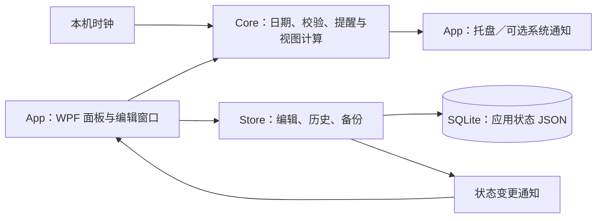

# 设计与取舍

本文描述当前实现。项目以单机桌面使用为目标，保留直接的 WPF 界面实现，没有引入服务端或多设备同步。

## 结构与数据流

App 项目用代码构建 WPF 控件，周视图、时间轴和窗口交互分布在 `PlannerWindow` 的多个 partial 文件中。Core 不依赖 WPF，便于独立运行日期、存储和历史检查。界面与 Windows 桌面、任务栏的交互仍需要实机验证。

## 重复日程与重叠显示

每周重复日程保存起止时间、重复结束日期和例外日期，按当前可见范围展开，不预先创建无限数量的事件。

修改“本次”时为原序列添加例外，并创建独立事件；修改“本次及以后”时截断旧序列并建立后续序列。这样可以保留已经过去的安排。重叠日程按时间区间分列，避免后一张卡片简单覆盖前一张。

## 保存、备份与撤销

数据库采用单行 `app_state` 表，保存版本号和完整应用状态 JSON。每次提交先验证数据，再在 SQLite 事务中更新；事务成功后才替换内存状态。

此方式适合当前个人日程规模：序列化、备份和状态恢复简单。代价是一次编辑会序列化完整状态，不适合直接当作大规模、多用户并发存储方案。项目未宣称任意数据量下的性能保证。

一次内容编辑保存“修改前／修改后”的日程与任务快照，最多保留 100 步。任务与子节点一起进入历史；删除任务后可以一次恢复全部节点。撤销或重做仍先提交数据库，成功后才移动历史位置。

外观、浏览位置、上次提醒检查时间及已发送提醒记录不进入内容快照。因此撤销任务编辑不会同时撤销主题设置或清除已经发送的提醒记录。退出后历史清空，已保存内容保留。

备份导出为 JSON。恢复前验证格式、保存恢复前备份，成功后清空内容历史。日常操作应使用程序内导出，避免在程序运行时仅复制 SQLite 主文件而遗漏 WAL 内容。

## 提醒

程序读取本机系统时间，约每 10 秒检查一次到期项；重新启动和系统唤醒后继续按保存的检查位置处理。任务与节点各自具有提醒开关和提前时间。

已发送提醒以去重键记录，完成项不再提醒。默认通过托盘展示；系统通知为显式选项，因为它需要额外的 Windows 通知注册。关闭程序时不存在独立的后台提醒服务。

当前使用本地日期时间，不提供跨时区协作或在线日历同步。

## 视图坐标与拖动

周／月视图缩放内容尺寸，时间轴缩放可见天数。二者采用不同的坐标计算，避免把日期范围缩放与文字、任务条尺寸混在一起。

时间轴浏览只改变视口起始日期；节点拖动才修改节点日期。拖动过程中保留原数据并显示临时预览，松手且目标有效时提交一次内容编辑；Esc、越界和回到原日期不产生历史。

条形粗细与行高独立设置。细条仍保留额外的点击区域；任务条自身不能被拖动改期，以减少误操作。

## 桌面与发布边界

桌面驻留、任务栏与原生窗口行为集中在 App 层；保留任务栏入口，因此 Win+D 会最小化面板。两个主面板共享应用生命周期和内容历史。

标准版与兼容版使用相同源码、安装标识及数据格式。兼容版仅改变启动文件的 CET 标记；这是一项启动兼容选择，不是新的功能分支。发布验证、未覆盖环境见 [测试说明](../TEST-REPORT.md)。
